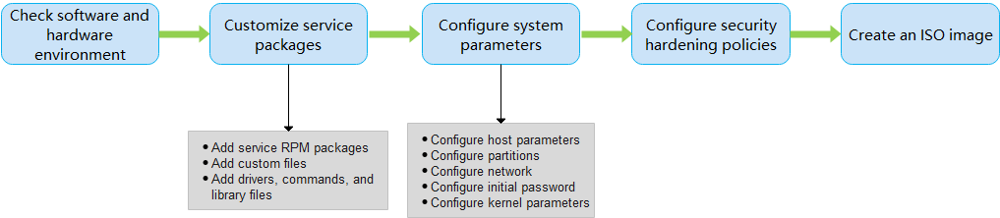

# imageTailor User Guide

## Introduction

In addition to the kernel, an operating system contains various peripheral packages. These peripheral packages provide functions of a general-purpose operating system but also cause the following problems:

- A large number of resources (such as memory, disks, and CPUs) are occupied, resulting in low system performance.
- Unnecessary functions increase the development and maintenance costs.

To address these problems, openEuler provides the imageTailor tool for tailoring and customization images. You can tailor unnecessary peripheral packages in the OS image or add service packages or files as required. This tool includes the following functions:

- System package tailoring: Tailors system commands, libraries, and drivers based on the list of RPM packages to be installed.
- System configuration modification: Configures the host name, startup services, time zone, network, partitions, drivers to be loaded, and kernel version.
- Software package addition: Adds custom RPM packages or files to the system.

## Installation

This section uses openEuler 22.03 LTS in the AArch64 architecture as an example to describe the installation method.

### Software and Hardware Requirements

The software and hardware requirements of imageTailor are as follows:

- The architecture is x86_64 or AArch64.

- The OS is openEuler 22.03 LTS (the kernel version is 5.10 and the Python version is 3.9, which meet the tool requirements).

- The root directory **/** of the host to run the tool have at least 40 GB space.

- The Python version is 3.9 or later.

- The kernel version is 5.10 or later.

- The SElinux service is disabled.

    ```shell
    $ sudo setenforce 0
    $ getenforce 
    Permissive
    ```

### Obtaining the Installation Package

Download the openEuler release package to install and use imageTailor.

1. Obtain the ISO image file and the corresponding verification file.

    The image must be an everything image. Assume that the image is to be stored in the **root** directory. Run the following commands:

    ```shell
    cd /root/temp
    wget https://repo.openeuler.org/openEuler-22.03-LTS/ISO/aarch64/openEuler-22.03-LTS-everything-aarch64-dvd.iso
    wget https://repo.openeuler.org/openEuler-22.03-LTS/ISO/aarch64/openEuler-22.03-LTS-everything-aarch64-dvd.iso.sha256sum
    ```

2. Obtain the verification value in the sha256sum verification file.

    ```shell
    cat openEuler-22.03-LTS-everything-aarch64-dvd.iso.sha256sum
    ```

3. Calculate the verification value of the ISO image file.

    ```shell
    sha256sum openEuler-22.03-LTS-everything-aarch64-dvd.iso
    ```

4. Compare the verification value in the sha256sum file with that of the ISO image. If they are the same, the file integrity is verified. Otherwise, the file integrity is damaged. You need to obtain the file again.

### Installing imageTailor

The following uses openEuler 22.03 LTS in AArch64 architecture as an example to describe how to install imageTailor.

1. Ensure that openEuler 22.03 LTS (or a running environment that meets the requirements of imageTailor) has been installed on the host.

    ```shell
    $ cat /etc/openEuler-release
    openEuler release 22.03 LTS
    ```

2. Create a **/etc/yum.repos.d/local.repo** file to configure the Yum source. The following is an example of the configuration file. **baseurl** indicates the directory for mounting the ISO image.

    ```shell
    [local]
    name=local
    baseurl=file:///root/imageTailor_mount
    gpgcheck=0
    enabled=1
    ```

3. Run the following commands as the **root** user to mount the image to the **/root/imageTailor_mount** directory as the Yum source (ensure that the value of **baseurl** is the same as that configured in the repo file and the disk space of the directory is greater than 20 GB):

    ```shell
    mkdir /root/imageTailor_mount
    sudo mount -o loop /root/temp/openEuler-22.03-LTS-everything-aarch64-dvd.iso /root/imageTailor_mount/
    ```

4. Make the Yum source take effect.

    ```shell
    yum clean all
    yum makecache
    ```

5. Install the imageTailor tool as the **root** user.

    ```shell
    sudo yum install -y imageTailor
    ```

6. Run the following command as the **root** user to verify that the tool has been installed successfully:

    ```shell
    $ cd /opt/imageTailor/
    $ sudo ./mkdliso -h
    -------------------------------------------------------------------------------------------------------------
    Usage: mkdliso -p product_name -c configpath [--minios yes|no|force] [-h] [--sec]
    Options:
        -p,--product     Specify the product to make, check custom/cfg_yourProduct.
        -c,--cfg-path    Specify the configuration file path, the form should be consistent with custom/cfg_xxx
        --minios         Make minios: yes|no|force
        --sec            Perform security hardening
        -h,--help        Display help information

    Example:
        command:
        ./mkdliso -p openEuler -c custom/cfg_openEuler --sec
    
        help:
        ./mkdliso -h
    -------------------------------------------------------------------------------------------------------------
    ```

### Directory Description

After imageTailor is installed, the directory structure of the tool package is as follows:

```shell
[imageTailor]
    |-[custom]
        |-[cfg_openEuler]
            |-[usr_file] // Stores files to be added.
            |-[usr_install] //Stores hook scripts to be added.
                |-[all]
                |-[conf]
                |-[hook]
            |-[cmd.conf] // Configures the default commands and libraries used by an ISO image.
            |-[rpm.conf] // Configures the list of RPM packages and drivers installed by default for an ISO image.
            |-[security_s.conf] // Configures security hardening policies.
            |-[sys.conf] // Configures ISO image system parameters.
    |-[kiwi] // Basic configurations of imageTailor.
    |-[repos] //RPM sources for obtaining the RPM packages required for creating an ISO image.
    |-[security-tool] // Security hardening tool.
    |-mkdliso // Executable script for creating an ISO image.
```

## Image Customization

This section describes how to use the imageTailor tool to package the service RPM packages, custom files, drivers, commands, and libraries to the target ISO image.

### Overall Process

The following figure shows the process of using imageTailor to customize an image.



The steps are described as follows:

- Check software and hardware environment: Ensure that the host for creating the ISO image meets the software and hardware requirements.

- Customize service packages: Add RPM packages (including service RPM packages, commands, drivers, and library files) and files (including custom files, commands, drivers, and library files).

    - Adding service RPM packages: Add RPM packages to the ISO image as required. For details, see [Installation](#installation).
    - Adding custom files: If you want to perform custom operations such as hardware check, system configuration check, and driver installation when the target ISO system is installed or started, you can compile custom files and package them to the ISO image.
    - Adding drivers, commands, and library files: If the RPM package source of openEuler does not contain the required drivers, commands, or library files, you can use imageTailor to package the corresponding drivers, commands, or library files into the ISO image.

- Configure system parameters:

    - Configuring host parameters: To ensure that the ISO image is successfully installed and started, you need to configure host parameters.
    - Configuring partitions: You can configure service partitions based on the service plan and adjust system partitions.
    - Configuring the network: You can set system network parameters as required, such as the NIC name, IP address, and subnet mask.
    - Configuring the initial password: To ensure that the ISO image is successfully installed and started, you need to configure the initial passwords of the **root** user and GRUB.
    - Configuring kernel parameters: You can configure the command line parameters of the kernel as required.

- Configure security hardening policies.

    imageTailor provides default security hardening policies. You can modify **security_s.conf** (in the ISO image customization phase) to perform secondary security hardening on the system based on service requirements. For details, see the [Security Hardening Guide](https://docs.openeuler.org/en/docs/22.03_LTS/docs/SecHarden/secHarden.html).

- Create an ISO image:

    Use the imageTailor tool to create an ISO image.

### Customizing Service Packages

You can pack service RPM packages, custom files, drivers, commands, and library files into the target ISO image as required.

#### Setting a Local repository

To customize an ISO image, you must set a repository in the **/opt/imageTailor/repos/euler_base/** directory. This section describes how to set a local repository.

1. Download the ISO file released by openEuler. (The RPM package of the everything image released by the openEuler must be used.)

    ```shell
    cd /opt
    wget https://repo.openeuler.org/openEuler-22.03-LTS/ISO/aarch64/openEuler-22.03-LTS-everything-aarch64-dvd.iso
    ```

2. Create a mount directory **/opt/openEuler_repo** and mount the ISO file to the directory.

    ```shell
    $ sudo mkdir -p /opt/openEuler_repo
    $ sudo mount openEuler-22.03-LTS-everything-aarch64-dvd.iso /opt/openEuler_repo
    mount: /opt/openEuler_repo: WARNING: source write-protected, mounted read-only.
    ```

3. Copy the RPM packages in the ISO file to the **/opt/imageTailor/repos/euler_base/** directory.

    ```shell
    $ sudo rm -rf /opt/imageTailor/repos/euler_base && sudo mkdir -p /opt/imageTailor/repos/euler_base
    $ sudo cp -ar /opt/openEuler_repo/Packages/* /opt/imageTailor/repos/euler_base
    $ sudo chmod -R 644 /opt/imageTailor/repos/euler_base
    $ sudo ls /opt/imageTailor/repos/euler_base|wc -l
    2577
    $ sudo umount /opt/openEuler_repo && sudo rm -rf /opt/openEuler_repo
    $ cd /opt/imageTailor
    ```

#### Adding Files

You can add files to an ISO image as required. The file types include custom files, drivers, commands, or library file. Store the files to the **/opt/imageTailor/custom/cfg_openEuler/usr_file** directory.

##### Precautions

- The commands to be packed must be executable. Otherwise, imageTailor will fail to pack the commands into the ISO.

- The file stored in the **/opt/imageTailor/custom/cfg_openEuler/usr_file** directory will be generated in the root directory of the ISO. Therefore, the directory structure of the file must be a complete path starting from the root directory so that imageTailor can place the file in the correct directory.

    For example, if you want **file1** to be in the **/opt** directory of the ISO, create an **opt** directory in the **usr_file** directory and copy **file1** to the **opt** directory. For example:

    ```shell
    $ pwd
     /opt/imageTailor/custom/cfg_openEuler/usr_file
    
    $ tree
      .
      ├── etc
      │   ├── default
      │   │   └── grub
      │   └── profile.d
      │       └── csh.precmd
      └── opt
          └── file1
      
      4 directories, 3 files
    ```

- The paths in **/opt/imageTailor/custom/cfg_openEuler/usr_file** must be real paths. For example, the paths do not contain soft links. You can run the `realpath` or `readlink -f` command to query the real path.

- If you need to invoke a custom script in the system startup or installation phase, that is, a hook script, store the file in the **hook** directory.

#### Adding RPM Packages

##### Procedure

To add RPM packages (drivers, commands, or library files) to an ISO image, perform the following steps:

> [!NOTE]NOTE
>
> - The **rpm.conf** and **cmd.conf** files are stored in the **/opt/imageTailor/custom/cfg_openEuler/** directory.
> - The RPM package tailoring granularity below indicates **sys_cut='no'**. For details about the cutout granularity, see [Configuring Host Parameters](#configuring-host-parameters).
> - If no local repository is configured, configure a local repository by referring to [Setting a Local repository](#setting-a-local-repository).
>

1. Check whether the **/opt/imageTailor/repos/euler_base/** directory contains the RPM package to be added.

    - If yes, go to step 2.
    - If no, go to step 3.

2. Configure the RPM package information in the **\<bootstrap>** section in the **rpm.conf** file.

    - For the RPM package tailoring granularity, no further action is required.
    - For other tailoring granularities, go to step 4.

3. Obtain the RPM package and store it in the **/opt/imageTailor/custom/cfg_openEuler/usr_rpm** directory. If the RPM package depends on other RPM packages, store the dependency packages to this directory because the added RPM package and its dependent RPM packages must be packed into the ISO image at the same time.

    - For the RPM package tailoring granularity, go to step 4.
    - For other tailoring granularities, no further action is required.

4. Configure the drivers, commands, and library files to be retained in the RPM package in the **rpm.conf** and **cmd.conf** files. If there are common files to be tailored, configure them in the **\<strip type="delete">\</strip>** section in the **cmd.conf** file.

##### Configuration File Description

| Operation        | Configuration File| Section                                                    |
| :----------- | :----------- | :----------------------------------------------------------- |
| Adding drivers    | rpm.conf     | \<drivers> <br>     \<file name="{driver_name}"><br>\</drivers><br>Note: The **driver_name** is the relative path of **/lib/modules/{kernel_version_number}/kernel/**.|
| Adding commands    | cmd.conf     | \<strip type="tools"><br>    \<file name="{command_name}"><br>\</strip> |
| Adding library files  | cmd.conf     | \<strip type="libs"><br>    \<file name="{library_file_name}"><br>\</strip> |
| Deleting other files| cmd.conf     | \<strip type="delete"><br>    \<file name="{file_name}"><br>\</strip><br>Note: The file name must be an absolute path.|

**Example**

- Adding drivers

    ```shell
    <drivers>
            <file name="arch/arm64/crypto/aes-ce-blk.ko"/>
            <file name="arch/arm64/crypto/aes-ce-ccm.ko"/>
            <file name="arch/arm64/crypto/aes-ce-cipher.ko"/>
        ......
    </drivers>
    ```

- Adding commands

    ```shell
    <strip type="tools">
        <file name="aarch64-openEuler-linux-gnu-pkg-config"/>
        <file name="accessdb"/>
        <file name="acyclic"/>
        ......
    </strip>
    ```

- Adding library files

    ```shell
    <strip type="tools">
        <file name="ANSI_X3.110"/>
        <file name="ARMSCII-8"/>
        <file name="ASMO_449"/>
    </strip>
    ```

- Deleting other files

    ```shell
    <strip type="delete">
        <file name="/usr/lib/firmware/radeon"/>
        <file name="/usr/lib/firmware/rtlwifi"/>
        <file name="/usr/lib/firmware/RTL8192E"/>
    </strip>
    ```

#### Adding Hook Scripts

A hook script is invoked by the OS during startup and installation to execute the actions defined in the script. The directory for storing hook scripts of imageTailor is **custom/cfg_openEuler/usr_install/hook directory**, which has different subdirectories. Each subdirectory represents an OS startup or installation phase. Store the scripts based on the phases in which the scripts are invoked.

##### Script Naming Rule

The script name must start with **S+number** (the number must be at least two digits). The number indicates the execution sequence of the hook script. Example: **S01xxx.sh**

> [!NOTE]NOTE
>
> The scripts in the **hook** directory are executed using the `source` command. Therefore, exercise caution when using the `exit` command in the scripts because the entire installation script exits after the `exit` command is executed.

##### Description of hook Subdirectories

| Subdirectory          | Script Example        | Time for Execution                     | Description                                                        |
| :-------------------- | :---------------------| :------------------------------- | :----------------------------------------------------------- |
| insmod_drv_hook       | N/A                   | After OS drivers are loaded                | N/A                                                          |
| custom_install_hook   | S01custom_install.sh  | After the drivers are loaded, that is, after **insmod_drv_hook** is executed| You can customize the OS installation process by using a custom script.|
| env_check_hook        | S01check_hw.sh        | Before the OS installation initialization                  | The script is used to check hardware specifications and types before initialization.|
| set_install_ip_hook   | S01set_install_ip.sh  | When network configuration is being performed during OS installation initialization.    | You can customize the network configuration by using a custom script.|
| before_partition_hook | S01checkpart.sh       | Before partitioning                    | You can check correctness of the partition configuration file by using a custom script.|
| before_setup_os_hook  | N/A                   | Before the repo file is decompressed                    | You can customize partition mounting.<br>If the decompression path of the installation package is not the root partition specified in the partition configuration, customize partition mounting and assign the decompression path to the input global variable.|
| before_mkinitrd_hook  | S01install_drv.sh     | Before the `mkinitrd` command is run          | The hook script executed before running the `mkinitrd` command when **initrd** is saved to the disk. You can add and update driver files in **initrd**.|
| after_setup_os_hook   | N/A                   | After OS installation                  | After the installation is complete, you can perform custom operations on the system files, such as modifying **grub.cfg**.|
| install_succ_hook     | N/A                   | When the OS is successfully installed            | The scripts in this subdirectory are used to parse the installation information and send information of whether the installation succeeds.**install_succ_hook** cannot be set to **install_break**.|
| install_fail_hook     | N/A                   | When the OS installation fails                    | The scripts in this subdirectory are used to parse the installation information and send information of whether the installation succeeds.**install_fail_hook** cannot be set to **install_break**.|

### Configuring System Parameters

Before creating an ISO image, you need to configure system parameters, including host parameters, initial passwords, partitions, network, compilation parameters, and system command line parameters.

#### Configuring Host Parameters

The **\<sysconfig> \</sysconfig>** section in the **/opt/imageTailor/custom/cfg_openEuler/sys.conf** file is used to configure common system parameters, such as the host name and kernel boot parameters.

The default configuration provided by openEuler is as follows. You can modify the configuration as required.

```shell
<sysconfig>
    sys_service_enable='ipcc'
    sys_service_disable='cloud-config cloud-final cloud-init-local cloud-init'
    sys_utc='yes'
    sys_timezone=''
    sys_cut='no'
    sys_usrrpm_cut='no'
    sys_hostname='Euler'
    sys_usermodules_autoload=''
    sys_gconv='GBK'
</sysconfig>
```

The parameters are described as follows:

- sys_service_enable

    This parameter is optional. Services enabled by the OS by default. Separate multiple services with spaces. If you do not need to add a system service, use the default value **ipcc**. Pay attention to the following during the configuration:

    - Default system services cannot be deleted.
    - You can configure service-related services, but the repository must contain the service RPM package.
    - By default, only the services configured in this parameter are enabled. If a service depends on other services, you need to configure the depended services in this parameter.

- sys_service_disable

    This parameter is optional. Services that are not allowed to automatically start upon system startup. Separate multiple services with spaces. If no system service needs to be disabled, leave this parameter blank.

- sys_utc

    (Mandatory) Indicates whether to use coordinated universal time (UTC) time. The value can be **yes** or **no**. The default value is **yes**.

- sys_timezone

    This parameter is optional. Sets the time zone. The value can be a time zone supported by openEuler, which can be queried in the **/usr/share/zoneinfo/zone.tab** file.

- sys_cut

    (Mandatory) Indicates whether to tailor the RPM packages. The value can be **yes**, **no**, or **debug**.**yes** indicates that the RPM packages are tailored. **no** indicates that the RPM packages are not tailored (only the RPM packages in the **rpm.conf** file is installed). **debug** indicates that the RPM packages are tailored but the `rpm` command is retained for customization after installation. The default value is **no**.

    > [!NOTE]NOTE
    > imageTailor installs the RPM package added by the user, deletes the files configured in the **\<script type="delete">\</script>** section of the **cmd.conf** file, and then deletes the commands, libraries, and drivers that are not configured in **cmd.conf** or **rpm.conf**.
    > When **sys_cut='yes'** is configured, imageTailor does not support the installation of the `rpm` command. Even if the `rpm` command is configured in the **rpm.conf** file, the configuration does not take effect.

- sys_usrrpm_cut

    (Mandatory) Indicates whether to tailor the RPM packages added by users to the **/opt/imageTailor/custom/cfg_openEuler/usr_rpm** directory. The value can be **yes** or **no**. The default value is **no**.

    - **sys_usrrpm_cut='yes'**: imageTailor installs the RPM packages added by the user, deletes the file configured in the **\<script type="delete">\</script>** section in the **cmd.conf** file, and then deletes the commands, libraries, and drivers that are not configured in **cmd.conf** or **rpm.conf**.

    - **sys_usrrpm_cut='no'**: imageTailor installs the RPM packages added by the user but does not delete the files in the RPM packages.

- sys_hostname

    (Mandatory) Host name. After the OS is deployed in batches, you are advised to change the host name of each node to ensure that the host name of each node is unique.

    The host name must be a combination of letters, digits, and hyphens (-) and must start with a letter or digit. Letters are case sensitive. The value contains a maximum of 63 characters. The default value is **Euler**.

- sys_usermodules_autoload

    (Optional) Driver loaded during system startup. When configuring this parameter, you do not need to enter the file extension **.ko**. If there are multiple drivers, separate them by space. By default, this parameter is left blank, indicating that no additional driver is loaded.

- sys_gconv

    (Optional) This parameter is used to tailor **/usr/lib/gconv** and **/usr/lib64/gconv**. The options are as follows:

    - **null**/**NULL**: indicates that this parameter is not configured. If **sys_cut='yes'** is configured, **/usr/lib/gconv** and **/usr/lib64/gconv** will be deleted.
    - **all**/**ALL**: keeps **/usr/lib/gconv** and **/usr/lib64/gconv**.
    - **xxx,xxx**: keeps the corresponding files in the **/usr/lib/gconv** and **/usr/lib64/gconv** directories. If multiple files need to be kept, use commas (,) to separate them.

- sys_man_cut

    (Optional) Indicates whether to tailor the man pages. The value can be **yes** or **no**. The default value is **yes**.

> [!NOTE]NOTE 
> If both **sys_cut** and **sys_usrrpm_cut** are configured, **sys_cut** is used. The following rules apply:

- sys_cut='no' 

No matter whether **sys_usrrpm_cut** is set to **yes** or **no**, the system RPM package tailoring granularity is used. That is, imageTailor installs the RPM packages in the repository and the RPM packages in the **usr_rpm** directory, however, the files in the RPM package are not deleted. Even if some files in the RPM packages are not required, imageTailor will delete them.

- sys_cut='yes'

1. sys_usrrpm_cut='no'

    System RPM package tailoring granularity: imageTailor deletes files in the RPM packages in the repositories as configured.

2. sys_usrrpm_cut='yes'

    System and user RPM package tailoring granularity: imageTailor deletes files in the RPM packages in the repositories and the **usr_rpm** directory as configured.

#### Configuring Initial Passwords

The **root** and GRUB passwords must be configured during OS installation. Otherwise, you cannot log in to the OS as the **root** user after the OS is installed using the tailored ISO image. This section describes how to configure the initial passwords.

> [!NOTE]NOTE 
> You must configure the initial **root** and GRUB passwords manually.

##### Configuring the Initial Password of the root User

###### Introduction

The initial password of the **root** user is stored in the **/opt/imageTailor/custom/cfg_openEuler/rpm.conf** file. You can modify this file to set the initial password of the **root** user.

> [!NOTE]NOTE
>
> - If the `--minios yes/force` parameter is required when you run the `mkdliso` command to create an ISO image, you need to enter the corresponding information in the **/opt/imageTailor/kiwi/minios/cfg_minios/rpm.conf** file.

The default configuration of the initial password of the **root** user in the **/opt/imageTailor/custom/cfg_openEuler/rpm.conf** file is as follows. Add a password of your choice.

```xml
<users group="root">
    <user pwd="${pwd}" home="/root" name="root"/>
</users>
```

The parameters are described as follows:

- **group**: group to which the user belongs.
- **pwd**: ciphertext of the initial password. The encryption algorithm is SHA-512. Replace **${pwd}** with the actual ciphertext.
- **home**: home directory of the user.
- **name**: name of the user to be configured.

###### Modification Method

Before creating an ISO image, you need to change the initial password of the **root** user. The following describes how to set the initial password of the **root** user (**root** permissions are required):

1. Add a user for generating a password, for example, **testUser**.

    ```shell
    sudo useradd testUser
    ```

2. Set the password of **testUser**. Run the following command and set the password as prompted:

    ```shell
    $ sudo passwd testUser
    Changing password for user testUser.
    New password: 
    Retype new password: 
    passwd: all authentication tokens updated successfully.
    ```

3. View the **/etc/shadow** file. The content following **testUser** (string between two colons) is the ciphertext of the password.

    ``` shell script
    $ sudo cat /etc/shadow | grep testUser
    testUser:$6$YkX5uFDGVO1VWbab$jvbwkZ2Kt0MzZXmPWy.7bJsgmkN0U2gEqhm9KqT1jwQBlwBGsF3Z59heEXyh8QKm3Qhc5C3jqg2N1ktv25xdP0:19052:0:90:7:35::
    ```

4. Copy and paste the ciphertext to the **pwd** field in the **/opt/imageTailor/custom/cfg_openEuler/rpm.conf** file.

    ``` shell script
    <users group="root">
        <user pwd="$6$YkX5uFDGVO1VWbab$jvbwkZ2Kt0MzZXmPWy.7bJsgmkN0U2gEqhm9KqT1jwQBlwBGsF3Z59heEXyh8QKm3Qhc5C3jqg2N1ktv25xdP0" home="/root" name="root"/>
    </users>
    ```

5. If the `--minios yes/force` parameter is required when you run the `mkdliso` command to create an ISO image, configure the **pwd** field of the corresponding user in **/opt/imageTailor/kiwi/minios/cfg_minios/rpm.conf**.

     ``` shell script
     <users group="root">
         <user pwd="$6$YkX5uFDGVO1VWbab$jvbwkZ2Kt0MzZXmPWy.7bJsgmkN0U2gEqhm9KqT1jwQBlwBGsF3Z59heEXyh8QKm3Qhc5C3jqg2N1ktv25xdP0" home="/root" name="root"/>
     </users>
     ```

##### Configuring the Initial GRUB Password

The initial GRUB password is stored in the **/opt/imageTailor/custom/cfg_openEuler/usr_file/etc/default/grub** file. Modify this file to configure the initial GRUB password. If the initial GRUB password is not configured, the ISO image will fail to be created.

> [!NOTE]NOTE
>
> - The **root** permissions are required for configuring the initial GRUB password.
> - The default user corresponding to the GRUB password is **root**.
> - The `grub2-set-password` command must exist in the system. If the command does not exist, install it in advance.

1. Run the following command and set the GRUB password as prompted:

    ```shell
    $ sudo grub2-set-password -o ./
    Enter password: 
    Confirm password: 
    grep: .//grub.cfg: No such file or directory
    WARNING: The current configuration lacks password support!
    Update your configuration with grub2-mkconfig to support this feature.
    ```

2. After the command is executed, the **user.cfg** file is generated in the current directory. The content starting with **grub.pbkdf2.sha512** is the encrypted GRUB password.

    ```shell
    $ sudo cat user.cfg 
    GRUB2_PASSWORD=grub.pbkdf2.sha512.10000.CE285BE1DED0012F8B2FB3DEA38782A5B1040FEC1E49D5F602285FD6A972D60177C365F1
    B5D4CB9D648AD4C70CF9AA2CF9F4D7F793D4CE008D9A2A696A3AF96A.0AF86AB3954777F40D324816E45DD8F66CA1DE836DC7FBED053DB02
    4456EE657350A27FF1E74429546AD9B87BE8D3A13C2E686DD7C71D4D4E85294B6B06E0615
    ```

3. Copy the preceding ciphertext and add the following configuration to the **/opt/imageTailor/custom/cfg_openEuler/usr_file/etc/default/grub** file:

    ```shell
    GRUB_PASSWORD="grub.pbkdf2.sha512.10000.CE285BE1DED0012F8B2FB3DEA38782A5B1040FEC1E49D5F602285FD6A972D60177C365F1
    B5D4CB9D648AD4C70CF9AA2CF9F4D7F793D4CE008D9A2A696A3AF96A.0AF86AB3954777F40D324816E45DD8F66CA1DE836DC7FBED053DB02
    4456EE657350A27FF1E74429546AD9B87BE8D3A13C2E686DD7C71D4D4E85294B6B06E0615"
    ```

#### Configuring Partitions

If you want to adjust system partitions or service partitions, modify the **\<HDpartitions >** section in the **/opt/imageTailor/custom/cfg_openEuler/sys.conf** file.

> [!NOTE]NOTE
>
> - System partition: partition for storing the OS.
> - Service partition: partition for service data.
> - The type of a partition is determined by the content it stores, not the size, mount path, or file system.
> - Partition configuration is optional. You can manually configure partitions after OS installation.

The format of **\<HDpartitions>** is as follows:

disk_ID   mount_path   partition _size   partition_type   file_system   \[Secondary formatting flag]

The default configuration is as follows:

```shell
<HDpartitions>
hd0    /boot        512M      primary     ext4     yes
hd0    /boot/efi    200M      primary     vfat     yes
hd0    /            30G       primary     ext4
hd0    -            -         extended    -
hd0    /var         1536M     logical     ext4
hd0    /home        max       logical     ext4
</HDpartitions>
```

The parameters are described as follows:

- disk_ID:
    ID of a disk. Set this parameter in the format of **hd***x*, where *x* indicates the *x*th disk.

    > [!NOTE]NOTE
    >
    > Partition configuration takes effect only when the disk can be recognized.

- mount_path:
    Mount path to a specified partition. You can configure service partitions and adjust the default system partition. If you do not mount partitions, set this parameter to **-**.

    > [!NOTE]NOTE
    >
    > - You must configure the mount path to **/**. You can adjust mount paths to other partitions according to your needs.
    > - When the UEFI boot mode is used, the partition configuration in the x86_64 architecture must contain the mount path **/boot**, and the partition configuration in the AArch64 architecture must contain the mount path **/boot/efi**.

- partition_size:
    The value types are as follows:

    - G/g: The unit of a partition size is GB, for example, 2G.
    - M/m: The unit of a partition size is MB, for example, 300M.
    - T/t: The unit of a partition size is TB, for example, 1T.
    - MAX/max: The rest space of a hard disk is used to create a partition. This value can only be assigned to the last partition.

    > [!NOTE]NOTE
    >
    > - A partition size value cannot contain decimal numbers. If there are decimal numbers, change the unit of the value to make the value an integer. For example, 1.5 GB should be changed to 1536 MB.
    > - When the partition size is set to **MAX**/**max**, the size of the remaining partition cannot exceed the limit of the supported file system type (the default file system type is **ext4**, and the maximum size is **16T**).

- partition_type:
    The values of partition types are as follows:

    - primary: primary partitions
    - extended: extended partition (configure only *disk_ID* for this partition)
    - logical: logical partitions

- file_system:
    Currently, **ext4** and **vfat** file systems are supported.

- Secondary formatting flag:
    Indicates whether to format the disk during secondary installation. This parameter is optional.

    - The value can be **yes** or **no**. The default value is **no**.

    > [!NOTE]NOTE
    >
    > Secondary formatting indicates that openEuler has been installed on the disk before this installation. If the partition table configuration (partition size, mount point, and file type) used in the previous installation is the same as that used in the current installation, this flag can be used to configure whether to format the previous partitions, except the **/boot** and **/** partitions. If the target host is installed for the first time, this flag does not take effect, and all partitions with specified file systems are formatted.

#### Configuring the Network

The system network parameters are stored in **/opt/imageTailor/custom/cfg_openEuler/sys.conf**. You can modify the network parameters of the target ISO image, such as the NIC name, IP address, and subnet mask, by configuring **\<netconfig-*x*>\</netconfig-*x*>** in this file.

The default network configuration in the **sys.conf** file is as follows. **netconfig-0** indicates the **eth0** NIC. If you need to configure an additional NIC, for example, **eth1**, add **\<netconfig-1>\</netconfig-1>** to the configuration file and set the parameters of **eth1**.

```shell
<netconfig-0>
BOOTPROTO="dhcp"
DEVICE="eth0"
IPADDR=""
NETMASK=""
STARTMODE="auto" 
</netconfig-0>
```

The following table describes the parameters.

| Parameter | Mandatory or Not| Value                                           | Description                                                        |
| :-------- | -------- | :------------------------------------------------ | :----------------------------------------------------------- |
| BOOTPROTO | Yes      | none / static / dhcp                              | **none**: No protocol is used for boot, and no IP address is assigned.<br>**static**: An IP address is statically assigned.<br>**dhcp**: An IP address is dynamically obtained using the dynamic host configuration protocol (DHCP).|
| DEVICE    | Yes      | Example: **eth1**                                         | NIC name.                                                    |
| IPADDR    | Yes      | Example: **192.168.11.100**                               | IP address.<br>This parameter must be configured only when the value of **BOOTPROTO** is **static**.|
| NETMASK   | Yes      | -                                                 | Subnet mask.<br>This parameter must be configured only when the value of **BOOTPROTO** is **static**.|
| STARTMODE | Yes      | manual / auto / hotplug / ifplugd / nfsroot / off | NIC start mode.<br>**manual**: A user runs the `ifup` command on a terminal to start an NIC.<br>**auto**/**hotplug**/**ifplug**/**nfsroot**: An NIC is started when the OS identifies it.<br>**off**: An NIC cannot be started in any situations.<br>For details about the parameters, run the `man ifcfg` command on the host that is used to create the ISO image.|

#### Configuring Kernel Parameters

To ensure stable and efficient running of the system, you can modify kernel command line parameters as required. For an OS image created by imageTailor, you can modify the **GRUB_CMDLINE_LINUX** configuration in the **/opt/imageTailor/custom/cfg_openEuler/usr_file/etc/default/grub** file to modify the kernel command line parameters. The default settings of the kernel command line parameters in **GRUB_CMDLINE_LINUX** are as follows:

```shell
GRUB_CMDLINE_LINUX="net.ifnames=0 biosdevname=0 crashkernel=512M oops=panic softlockup_panic=1 reserve_kbox_mem=16M crash_kexec_post_notifiers panic=3 console=tty0"
```

The meanings of the configurations are as follows (for details about other common kernel command line parameters, see related kernel documents):

- net.ifnames=0 biosdevname=0

    Name the NIC in traditional mode.

- crashkernel=512M

    The memory space reserved for kdump is 512 MB.

- oops=panic panic=3

    The kernel panics when an oops error occurs, and the system restarts 3 seconds later.

- softlockup_panic=1

    The kernel panics when a soft-lockup is detected.

- reserve_kbox_mem=16M

    The memory space reserved for Kbox is 16 MB.

- console=tty0

    Specifies **tty0** as the output device of the first virtual console.

- crash_kexec_post_notifiers

    After the system crashes, the function registered with the panic notification chain is called first, and then kdump is executed.

### Creating an Image

After customizing the operating system, you can use the `mkdliso` script to create the OS image file. The OSimage created using imageTailor is an ISO image file.

#### Command Description

##### Syntax

**mkdliso -p openEuler -c custom/cfg_openEuler \[--minios yes\|no\|force] \[--sec] \[-h]**

##### Parameter Description

| Parameter| Mandatory| Description                                                     | Value Range                                                    |
| -------- | -------- | ------------------------------------------------------------ | ------------------------------------------------------------ |
| -p       | Yes      | Specifies the product name.                                                | **openEuler**                                                    |
| c        | Yes      | Specifies the relative path of the configuration file.                                      | **custom/cfg_openEuler**                                         |
| --minios | No      | Specifies whether to create the **initrd** file that is used to boot the system during system installation.                       | The default value is **yes**.<br>**yes**: The **initrd** file will be created when the command is executed for the first time. When a subsequent `mkdliso` is executed, the system checks whether the **initrd** file exists in the **usr_install/boot** directory using sha256 verification. If the **initrd** file exists, it is not created again. Otherwise, it is created.<br>**no**: The **initrd** file is not created. The **initrd** file used for system boot and running is the same.<br>**force**: The **initrd** file will be created forcibly, regardless of whether it exists in the **usr_install/boot** directory or not.|
| --sec    | No      | Specifies whether to perform security hardening on the generated ISO file.<br>If this parameter is not specified, the user should undertake the resultant security risks| N/A                                                          |
| -h       | No      | Obtains help information.                                                | N/A                                                          |

#### Image Creation Guide

To create an ISO image using`mkdliso`, perform the following steps:

> [!NOTE]NOTE:
>
> - The absolute path to `mkdliso` must not contain spaces. Otherwise, the ISO image creation will fail.
> - In the environment for creating the ISO image, the value of **umask** must be set to **0022**.

1. Run the `mkdliso` command as the **root** user to generate the ISO image file. The following command is used for reference:

    ```shell
    # sudo /opt/imageTailor/mkdliso -p openEuler -c custom/cfg_openEuler --sec
    ```

    After the command is executed, the created files are stored in the **/opt/imageTailor/result/{date}** directory, including **openEuler-aarch64.iso** and **openEuler-aarch64.iso.sha256**.

2. Verify the integrity of the ISO image file. Assume that the date and time is **2022-03-21-14-48**.

    ```shell
    cd /opt/imageTailor/result/2022-03-21-14-48/
    sha256sum -c openEuler-aarch64.iso.sha256
    ```

    If the following information is displayed, the ISO image creation is complete.

    ```text
    openEuler-aarch64.iso: OK
    ```

    If the following information is displayed, the image is incomplete. The ISO image file is damaged and needs to be created again.

    ```shell
    openEuler-aarch64.iso: FAILED
    sha256sum: WARNING: 1 computed checksum did NOT match
    ```

3. View the logs.

    After an image is created, you can view logs as required (for example, when an error occurs during image creation). When an image is created for the first time, the corresponding log file and security hardening log file are compressed into a TAR package (the log file is named in the format of **sys_custom_log_{Date}.tar.gz**) and stored in the **result/log directory**. Only the latest 50 compressed log packages are stored in this directory. If the number of compressed log packages exceeds 50, the earliest files will be overwritten.

### Tailoring Time Zones

After the customized ISO image is installed, you can tailor the time zones supported by the openEuler system as required. This section describes how to tailor the time zones.

The information about time zones supported by openEuler is stored in the time zone folder **/usr/shre/zoninfo**. You can run the following command to view the time zone information:

```shell
$ ls /usr/share/zoneinfo/
Africa/  America/  Asia/  Atlantic/  Australia/  Etc/  Europe/
Pacific/  zone.tab
```

Each subfolder represents an area. The current areas include continents, oceans, and **Etc**. Each area folder contains the locations that belong to it. Generally, a location is a city or an island.

All time zones are in the format of *area/location*. For example, if China Standard Time is used in southern China, the time zone is Asia/Shanghai (location may not be the capital). The corresponding time zone file is:

```texta
/usr/share/zoneinfo/Asia/Shanghai
```

If you want to tailor some time zones, delete the corresponding time zone files.

### Customization Example

This section describes how to use imageTailor to create an ISO image.

1. Check whether the environment used to create the ISO meets the requirements.

    ``` shell
    $ cat /etc/openEuler-release
    openEuler release 22.03 LTS
    ```

2. Ensure that the root directory has at least 40 GB free space.

    ```shell
    $ df -h
    Filesystem                  Size  Used Avail Use% Mounted on
    ......
    /dev/vdb                    196G   28K  186G   1% /
    ```

3. Install the imageTailor tailoring tool. For details, see [Installation](#installation).

    ```shell
    $ sudo yum install -y imageTailor
    $ ll /opt/imageTailor/
    total 88K
    drwxr-xr-x.  3 root root 4.0K Mar  3 08:00 custom
    drwxr-xr-x. 10 root root 4.0K Mar  3 08:00 kiwi
    -r-x------.  1 root root  69K Mar  3 08:00 mkdliso
    drwxr-xr-x.  2 root root 4.0K Mar  9 14:48 repos
    drwxr-xr-x.  2 root root 4.0K Mar  9 14:48 security-tool
    ```

4. Configure a local repository.

    ```shell
    $ wget https://repo.openeuler.org/openEuler-22.03-LTS/ISO/aarch64/openEuler-22.03-LTS-everything-aarch64-dvd.iso
    $ sudo mkdir -p /opt/openEuler_repo
    $ sudo mount openEuler-22.03-LTS-everything-aarch64-dvd.iso /opt/openEuler_repo
    mount: /opt/openEuler_repo: WARNING: source write-protected, mounted read-only.
    $ sudo rm -rf /opt/imageTailor/repos/euler_base && sudo mkdir -p /opt/imageTailor/repos/euler_base
    $ sudo cp -ar /opt/openEuler_repo/Packages/* /opt/imageTailor/repos/euler_base
    $ sudo chmod -R 644 /opt/imageTailor/repos/euler_base
    $ sudo ls /opt/imageTailor/repos/euler_base|wc -l
    2577
    $ sudo umount /opt/openEuler_repo && sudo rm -rf /opt/openEuler_repo
    $ cd /opt/imageTailor
    ```

5. Change the **root** and GRUB passwords.

    Replace **\${pwd}** with the encrypted password by referring to [Configuring Initial Passwords](#configuring-initial-passwords).

    ```shell
    $ cd /opt/imageTailor/
    $ sudo vi custom/cfg_openEuler/usr_file/etc/default/grub
    GRUB_PASSWORD="${pwd1}"
    $ 
    $ sudo vi kiwi/minios/cfg_minios/rpm.conf
    <users group="root">
       <user pwd="${pwd2}" home="/root" name="root"/>
    </users>
    $ 
    $ sudo vi custom/cfg_openEuler/rpm.conf
    <users group="root">
       <user pwd="${pwd2}" home="/root" name="root"/>
    </users>
    ```

6. Run the tailoring command.

    ```shell
    $ sudo rm -rf /opt/imageTailor/result
    $ sudo ./mkdliso -p openEuler -c custom/cfg_openEuler --minios force
    ......
    Complete release iso file at: result/2022-03-09-15-31/openEuler-aarch64.iso
    move all mkdliso log file to result/log/sys_custom_log_20220309153231.tar.gz
    $ ll result/2022-03-09-15-31/
    total 889M
    -rw-r--r--. 1 root root 889M Mar  9 15:32 openEuler-aarch64.iso
    -rw-r--r--. 1 root root   87 Mar  9 15:32 openEuler-aarch64.iso.sha256
    ```
